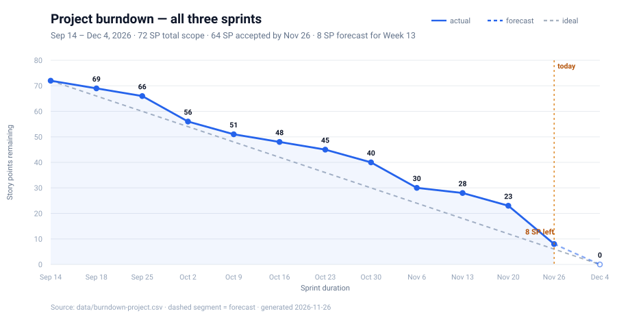
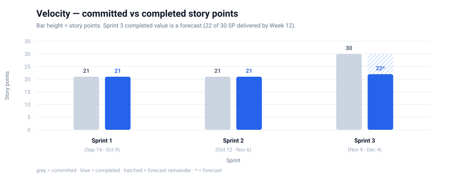

# Burndown & Velocity — method and data

## 1. What is burned down

We track **story points remaining**, not hours, because the backlog is estimated in points and
the team works part-time. Hours are tracked separately for the contribution table
(`CONTRIBUTIONS.md`).

- **Daily points** for each sprint, recorded by the Scrum Master after the async stand-up.
- **Weekly points** for the project, taken at the Monday standing meeting (end-of-week value).
- Ideal line = linear from the committed scope at sprint start to zero at the last working day.
  It is a reference, not a target: the step shape is expected because a story is only burned
  when its acceptance tests pass and the PR is merged.

A point is burned **only when a story is accepted** at review (or explicitly accepted mid-sprint
by the Product Owner after the DoD checklist). Work in progress stays on the chart — that is why
the curve is flat for several days and then drops by 3–5 points.

## 2. Data files

| File | Granularity | Used by |
| --- | --- | --- |
| `data/burndown-sprint-1.csv` | daily, 20 working days | Sprint 1 chart |
| `data/burndown-sprint-2.csv` | daily, 20 working days | Sprint 2 chart |
| `data/burndown-sprint-3.csv` | daily, 20 working days (days 14–19 forecast) | Sprint 3 chart |
| `data/burndown-project.csv` | weekly, 13 checkpoints | Project chart |
| `data/velocity.csv` | per sprint | Velocity chart |

CSV columns: index (`day`/`week`), `date`, `remaining_sp`, `forecast` (1 = projected),
`today` (1 = current day marker), `note` (what moved the line).

## 3. Charts

| Chart | File |
| --- | --- |
| Sprint 1 | [`charts/burndown-sprint-1.svg`](charts/burndown-sprint-1.svg) |
| Sprint 2 | [`charts/burndown-sprint-2.svg`](charts/burndown-sprint-2.svg) |
| Sprint 3 | [`charts/burndown-sprint-3.svg`](charts/burndown-sprint-3.svg) |
| Project (all sprints) | [`charts/burndown-project.svg`](charts/burndown-project.svg) |
| Velocity | [`charts/velocity.svg`](charts/velocity.svg) |
| Dashboard (all charts + tables) | [`burndown.html`](burndown.html) |





## 4. Regenerate after every update

```bash
# edit the CSV row for today, flip forecast 1 -> 0 when a day becomes history
python tools/make_burndown.py
```

The script rewrites `charts/*.svg` and `burndown.html` (self-contained, no network, stdlib only).
Commit the CSV and the regenerated files together so the evidence and the chart never diverge.

## 5. Current numbers (2026-11-26)

| Sprint | Committed | Accepted | Velocity |
| --- | --- | --- | --- |
| Sprint 1 (Sep 14 – Oct 9) | 21 | 21 | 21 |
| Sprint 2 (Oct 12 – Nov 6) | 21 | 21 | 21 |
| Sprint 3 (Nov 9 – Dec 4) | 30 | 22 (8 forecast) | 30 (forecast) |
| **Project** | **72** | **64** | mean closed-sprint velocity **21** |

