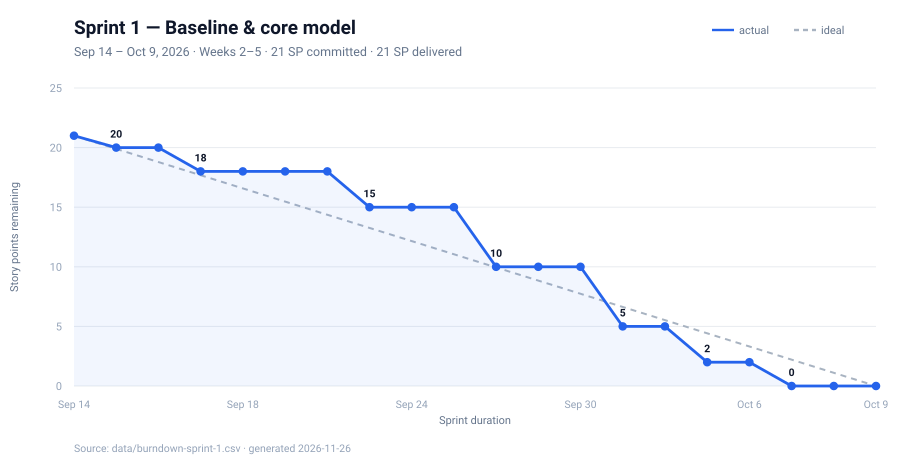

# Sprint 1 — Baseline & core model

**Dates:** 2026-09-14 → 2026-10-09 (Weeks 2–5) · **Milestone:** `Sprint 1` ·
**Goal:** produce a trustworthy four-state diff of two revisions without touching the user's
working tree, and prove the fork does not alter upstream behaviour.

| Item | Value |
| --- | --- |
| Committed | 21 SP |
| Delivered | 21 SP (100%) |
| Capacity | ~72 h (6 × 4 weeks × 3 h) |
| Planned tasks | 75 h |
| Sprint review | 2026-10-09, 45 min |
| Retrospective | 2026-10-09, 30 min |

## 1. Sprint backlog

| ID | Story | Task | Owner | Est. | Status | Evidence |
| --- | --- | --- | --- | --- | --- | --- |
| US-07 | Process scaffolding | Fork, milestones, labels, issue/PR templates, board | M2 | 2 h | Done | PR #26 |
| US-07 | Process scaffolding | ADR template + risk register seed | M1 | 2 h | Done | `adr/`, `RISK_REGISTER.md` |
| US-07 | Process scaffolding | Weekly-note folder + meeting cadence | M2 | 2 h | Done | `meetings/` |
| US-04 | Worktree provider | `version_provider.py`: repo root, `git worktree add --detach`, cleanup | M3 | 6 h | Done | PR #27 |
| US-04 | Worktree provider | Dirty-tree and invalid-ref tests | M6 | 2 h | Done | `test_delta.py` |
| US-05 | Baseline snapshot | `baseline.py` write/diff, relative paths, deterministic order | M4 | 6 h | Done | PR #31 |
| US-05 | Baseline snapshot | CLI flags + operational docs (two traps) | M4 | 2 h | Done | `docs/delta.md` |
| US-05 | Baseline snapshot | Baseline round-trip tests | M6 | 2 h | Done | `test_baseline.py` |
| US-01 | Two-version analysis | Unified `Finding` model | M5 | 4 h | Done | `finding.py` |
| US-01 | Two-version analysis | `delta.py` CLI, orchestration, text/JSON report | M3 | 10 h | Done | PR #28 |
| US-01 | Two-version analysis | End-to-end fixture test | M6 | 4 h | Done | `test_e2e.py` |
| US-02 | Exact fingerprint | Normalisation + exact matching, no line numbers | M4 | 10 h | Done | PR #29 |
| US-02 | Exact fingerprint | Line-shift fixture and invariance tests | M6 | 6 h | Done | `test_fingerprint.py` |
| US-03 | Four states | Classification and summary counts | M5 | 6 h | Done | PR #30 |
| US-03 | Four states | State tests across NEW/UNCHANGED/RESOLVED | M5 | 4 h | Done | `test_delta.py` |
| US-06 | Upstream compatibility | Byte-level diff harness for text/JSON | M2 | 4 h | Done | PR #32 |
| US-06 | Upstream compatibility | CI matrix wiring, baseline made green | M1 | 3 h | Done | `ci.yml` |
|  |  | **Total** |  | **75 h** |  |  |

## 2. Burndown

| Checkpoint | Day | Remaining | Note |
| --- | --- | --- | --- |
| Sep 14 | 0 | 21 | Planning; all 7 stories committed |
| Sep 17 | 3 | 18 | US-04 merged; worktree cleanup test is the first red build |
| Sep 23 | 7 | 15 | US-05 merged after two review rounds on path normalisation |
| Sep 28 | 10 | 10 | US-01 merged; first demo of the four-state report |
| Oct 1 | 13 | 5 | US-02 merged; line-shift invariant proven |
| Oct 5 | 15 | 2 | US-03 merged |
| Oct 7 | 17 | 0 | US-06 merged; upstream byte-compat pinned |
| Oct 9 | 19 | 0 | Review + retro |

The curve is step-shaped because stories were accepted only after review; no story was marked
done on partial tests. Two flat stretches (Sep 18–22, Sep 24–27) correspond to review latency,
not idle work.

## 3. Sprint review

**Demo script (executed):**

1. On `tests/fixtures/sample_project`, run `pyexamine-delta . --base main --head HEAD` → the
   four counts appear, only the introduced Long Method is `NEW`.
2. Insert 20 blank lines above an existing smell → still `UNCHANGED`; fingerprint identical.
3. Remove one smell → `RESOLVED`, with the correct symbol.
4. Show `git status --porcelain` before/after → identical.
5. Show text (967 bytes) and JSON (5366 bytes) outputs identical to upstream v0.3.0.

**Verdict:** US-01 through US-07 accepted (21/21 SP).

**Feedback received (peers from another group):**

- “The report should say *why* something is new, not only that it is new.” → became US-13's
  explainable reasons and US-10's metric values.
- “Line filter in CI would be simpler.” → tested as Baseline B in the evaluation contract; the
  counter-example is a moved function, which the naive filter reports as one NEW + one RESOLVED.

**Carry-over:** none. US-08 (AST signature) was pulled forward only as a spike, not committed.

## 4. Retrospective

| Start | Stop | Continue |
| --- | --- | --- |
| Writing the acceptance scenario before the implementation | Merging with only the local 3.11 interpreter tested | Pairing on the fingerprint design |
| Recording the decision (and rejected alternative) in the meeting note | Silent scope adds inside a PR | Byte-compat harness as a merge gate |

**Actions:**

| # | Action | Owner | Due | Result |
| --- | --- | --- | --- | --- |
| A1 | Run the 3.10–3.14 matrix before requesting review | M6 | Oct 12 | Done |
| A2 | Every PR body must paste the test command and result | M2 | Oct 12 | Done (template updated) |
| A3 | Add a “rejected alternative” line to every ADR | M1 | Oct 16 | Done |
| A4 | Time-box spikes to 2 h and record the outcome in the issue | M3 | Oct 16 | Done |

## 5. Evidence index

- Issues: #1 (scaffolding), #2 (worktree), #3 (two-version), #4 (fingerprint), #5 (states),
  #6 (baseline), #7 (compat).
- Pull requests: #26, #27, #28, #29, #30, #31, #32.
- Tests added: 63 (suite 216 → 279).
- Meeting notes: `meetings/week-02.md` … `week-05.md`.
- ADR: none accepted this sprint; ADR-008 assigned to Sprint 3.
- Risk register reviewed on 2026-10-09 (R1 closed: upstream ran deterministically on 6
  interpreters).