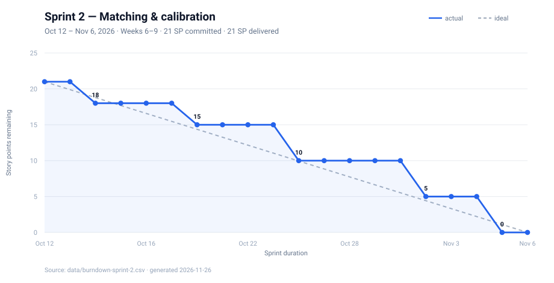

# Sprint 2 — Matching & calibration

**Dates:** 2026-10-12 → 2026-11-06 (Weeks 6–9) · **Milestone:** `Sprint 2` ·
**Goal:** a moved or renamed smell keeps its identity, and thresholds are learned from the
project rather than from a library average.

| Item | Value |
| --- | --- |
| Committed | 21 SP |
| Delivered | 21 SP (100%) |
| Capacity | ~72 h |
| Planned tasks | 72 h |
| Sprint review | 2026-11-06, 45 min |
| Retrospective | 2026-11-06, 30 min |

## 1. Sprint backlog

| ID | Story | Task | Owner | Est. | Status | Evidence |
| --- | --- | --- | --- | --- | --- | --- |
| US-08 | AST signature | Normalisation rules: names, docstrings, literals, comments | M4 | 12 h | Done | PR #33 |
| US-08 | AST signature | Golden signatures for the three focal code smells | M6 | 6 h | Done | `test_structure.py` |
| US-09 | Fuzzy matching | `fuzzy.py` scoring: symbol, path, AST, line proximity, metric range | M3 | 12 h | Done | PR #34 |
| US-09 | Fuzzy matching | Threshold sweep 0.50–0.75 and precision fixtures | M5 | 6 h | Done | `test_fuzzy.py` |
| US-10 | WORSENED | `metrics.py` rule → measured value + threshold; `worsen_detail` | M5 | 8 h | Done | PR #35 |
| US-10 | WORSENED | Metric propagation tests (50 → 82 lines case) | M6 | 2 h | Done | `test_worsened.py` |
| US-11 | Calibration | `calibration.py`: percentiles, floors, max-multiplier, YAML | M4 | 12 h | Done | PR #36 |
| US-11 | Calibration | CLI integration, guard rails, docs | M1 | 4 h | Done | `docs/delta.md` |
| US-12 | Mutation corpus | 24 controlled commits in a sandbox repository | M2 | 6 h | Done | PR #37 |
| US-12 | Mutation corpus | `manifest.csv` with expected states + replay script | M1 | 4 h | Done | `EVALUATION_CONTRACT.md` |
|  |  | **Total** |  | **72 h** |  |  |

## 2. Burndown

| Checkpoint | Day | Remaining | Note |
| --- | --- | --- | --- |
| Oct 12 | 0 | 21 | Planning; US-08 as the sprint backbone |
| Oct 14 | 2 | 18 | US-10 merged (metric table unblocks risk later) |
| Oct 20 | 6 | 15 | US-12 merged; corpus tagged `eval-corpus-v1` |
| Oct 26 | 10 | 10 | US-08 merged after normalisation review |
| Nov 2 | 15 | 5 | US-09 merged; pure move now yields no false NEW |
| Nov 5 | 18 | 0 | US-11 merged; calibrated YAML reviewed |
| Nov 6 | 19 | 0 | Review; evaluation contract frozen |

The slope flattens between Oct 22 and Nov 1: the fuzzy threshold sweep consumed the buffer and
produced two rejected implementations (pure token similarity, then path-first scoring). The
accepted option combines symbol + path + AST with line proximity as a tie-breaker.

## 3. Sprint review

**Demo script (executed):**

1. `git mv` a module and rename two functions → rerun diff → **0 NEW, 0 RESOLVED**, all affected
   findings `UNCHANGED` (or `WORSENED` where metrics changed).
2. `--no-fuzzy` on the same commit → the old failure returns (1 NEW + 1 RESOLVED), proving the
   second pass is doing the work.
3. `pyexamine-delta calibrate . --percentile 95 --max-multiplier 2` → YAML with five thresholds;
   on a small project every value is clamped at the research floor.
4. Replay the 24-commit corpus → predicted states match expected states for the 5 focal smells
   except one known case (a function split into two, recorded as a limitation).

**Verdict:** US-08 through US-12 accepted (21/21 SP).

**Feedback received:**

- “If a function is split in two, the second half looks new.” → recorded as a limitation and as
  risk R3; not solved inside the sprint.
- “Thresholds should not silently change the gate.” → calibration writes a file a human commits;
  this is now an explicit acceptance criterion (US-11 AC-3).

## 4. Retrospective

| Start | Stop | Continue |
| --- | --- | --- |
| Measuring precision on real repositories before tuning a heuristic | Extending a spike into the sprint without a written stop rule | The frozen-corpus discipline |
| Splitting evaluation work into “corpus” and “analysis” stories | Comparing implementations by eyeballing diffs | Recording rejected thresholds with numbers |

**Actions:**

| # | Action | Owner | Due | Result |
| --- | --- | --- | --- | --- |
| B1 | Freeze the evaluation contract before any tuning in Sprint 3 | M1 | Nov 6 | Done (`EVALUATION_CONTRACT.md`) |
| B2 | Every heuristic change includes a precision sample from real code | M3 | Nov 13 | Done |
| B3 | Add a cross-file move fixture to `test_fuzzy.py` | M6 | Nov 13 | Done |
| B4 | Risk score deferred to Sprint 3 to protect the buffer | M1 | Nov 9 | Done (change log) |

## 5. Evidence index

- Issues: #8 (AST signature), #9 (fuzzy), #10 (WORSENED), #11 (calibration), #12 (corpus).
- Pull requests: #33, #34, #35, #36, #37.
- Tests added: 96 (suite 279 → 375).
- Meeting notes: `meetings/week-06.md` … `week-09.md`.
- ADRs: ADR-009 drafted (reliability — staged matching); reviewed at the sprint review.
- Evaluation contract frozen on 2026-11-06; no metric changed afterwards.