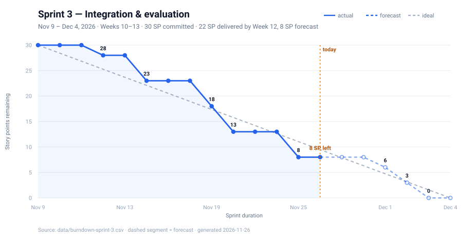

# Sprint 3 — Integration & evaluation

**Dates:** 2026-11-09 → 2026-12-04 (Weeks 10–13) · **Milestone:** `Sprint 3` ·
**Goal:** make the tool usable in a real PR workflow (Markdown/SARIF, exit-code gate, Actions),
meet the performance budget with a cache, and execute the frozen evaluation.

| Item | Value |
| --- | --- |
| Committed | 30 SP (8 SP is the evaluation story) |
| Delivered by 2026-11-26 | 22 SP |
| Forecast | 30 SP by 2026-12-03 |
| Capacity | ~96 h + wrap-up week |
| Planned tasks | 96 h |
| Sprint review | 2026-12-04 (planned) |
| Retrospective | 2026-12-04 (planned) |

Status legend: **Done** = merged and accepted; **In progress** = code merged, evaluation or
verification still running; **Planned** = not started.

## 1. Sprint backlog

| ID | Story | Task | Owner | Est. | Status | Evidence |
| --- | --- | --- | --- | --- | --- | --- |
| US-15 | PR summary | Text + Markdown renderer, truncation, step-summary format | M1 | 6 h | Done | PR #40 |
| US-13 | Risk score | Four weighted components + `changed_lines` via `git diff` | M3 | 12 h | Done | PR #38 |
| US-13 | Risk score | Explanation lines (introduced by PR, value vs threshold, overlap, callers) | M5 | 4 h | Done | `test_risk.py` |
| US-14 | SARIF | `sarif_builder.py`, 47 rule descriptors, URI/path handling | M6 | 12 h | Done | PR #39 |
| US-14 | SARIF | Level policies (triage/strict/advisory) + validation tests | M6 | 4 h | Done | `test_sarif.py` |
| US-16 | Gate | `--fail-on-new`, `--max-new`, `--min-risk`, `--fail-on-worsened`, exit codes | M3 | 6 h | Done | PR #41 |
| US-16 | Gate | Severity-before-budget tests, usage-error paths | M2 | 3 h | Done | `test_delta_cli.py` |
| US-17 | Actions | Workflow, `fetch-depth: 0`, baseline step, summary step, SARIF upload | M2 | 6 h | Done | PR #42 |
| US-18 | Cache | Manifest hashing, threshold/version digest, path re-rooting | M4 | 14 h | Done | PR #43 · ADR-008 |
| US-18 | Cache | Cache-hit equivalence and invalidation tests | M6 | 2 h | Done | `test_cache.py` |
| US-19 | Evaluation | Annotation round 2 on the frozen sample (2 annotators) | M1 | 8 h | In progress | `EVALUATION_CONTRACT.md` |
| US-19 | Evaluation | Baseline A/B re-runs on the frozen corpus | M5 | 8 h | Planned (Nov 30) | — |
| US-19 | Evaluation | Metrics + charts + comparison table | M3 | 6 h | Planned (Dec 1) | — |
| US-19 | Evaluation | Report evaluation section (2–5 pages) | M4 | 5 h | Planned (Dec 2) | — |
|  |  | **Total** |  | **96 h** |  |  |

## 2. Burndown (live)



| Checkpoint | Day | Remaining | Note |
| --- | --- | --- | --- |
| Nov 9 | 0 | 30 | Planning; 30 SP committed (deliberate stretch) |
| Nov 12 | 3 | 28 | US-15 merged |
| Nov 16 | 5 | 23 | US-13 merged; risk reasons reviewed with two peers |
| Nov 19 | 8 | 18 | US-14 merged; SARIF validates |
| Nov 20 | 9 | 13 | US-16 + US-17 merged; local reproduction of CI gate works |
| Nov 25 | 12 | 8 | US-18 merged; ADR-008 accepted |
| **Nov 26** | **13** | **8** | **Today — evaluation in progress** |
| Nov 27 | 14 | 8 | Forecast: annotation round 2 closes |
| Nov 30 | 15 | 8 | Forecast: baseline A/B re-runs |
| Dec 1 | 16 | 6 | Forecast: metrics table |
| Dec 2 | 17 | 3 | Forecast: report section |
| Dec 3 | 18 | 0 | Forecast: evaluation accepted |
| Dec 4 | 19 | 0 | Review, wrap-up, slide + video freeze |

Days 14–19 are dashed in the chart and must be converted to actual values as they happen
(`forecast` 1 → 0 in `data/burndown-sprint-3.csv`).

## 3. What is already demonstrable (as of 2026-11-26)

End-to-end flow that works today:

```bash
# 1. once, on main: snapshot the baseline
pyexamine-delta . --base HEAD --head HEAD --baseline-mode write

# 2. on a PR: only what the PR introduced, ranked by risk, as a PR comment
pyexamine-delta . --base origin/main --format markdown --risk

# 3. the gate used by CI
pyexamine-delta . --base origin/main --head HEAD \
  --baseline-mode diff --risk --min-risk 40 --fail-on-new medium --max-new 20
```

Observed behaviour to demo at the sprint review:

- A PR that adds an 82-line method fails with
  `gate: 1 new finding(s) at or above 'medium' - failing the run` and prints the four risk
  reasons for `payment.process_order`.
- After splitting the method, the gate exits `0`; the previous finding becomes `RESOLVED`.
- SARIF output loads in GitHub code scanning (public repo or GHAS-enabled repo) and annotates
  the changed line.
- A second run on an unchanged tree is served from `.pyexamine-cache/`; the warm run is dominated
  by manifest hashing (measurement still to be recorded in the evaluation table).

## 4. Quality status

| Check | Result (2026-11-25) |
| --- | --- |
| `python -m pytest tests -q` | 431 passed (216 upstream + 215 new) |
| `ruff check src tests` | clean |
| Upstream output compatibility | text 967 bytes / JSON 5366 bytes, identical to v0.3.0 |
| Test files | 18 (`test_delta.py`, `test_fingerprint.py`, `test_fuzzy.py`, `test_risk.py`, `test_sarif.py`, `test_cache.py`, …) |
| Public API stability | `analyze_code_quality` unchanged; `pyexamine-delta` is an additional entry point |

## 5. Remaining work and risks

| Item | Risk | Mitigation / stop rule |
| --- | --- | --- |
| Annotation round 2 (26 remaining commits/PRs) | Two annotators disagree on “worsened” cases | Adjudication rule fixed in the contract (metric crossing wins); κ reported; if κ < 0.60, report per-annotator results and discuss |
| Baseline A/B re-runs | Upstream full runs are slow on largest repo | Time-box to 3 repositories if needed; record the sampling rule before running |
| Benchmark environment | Laptop vs CI timing differences | Report both; NFR is judged on the agreed environment stated in ADR-008 |
| Report + video in the same week | Time collision with evaluation | Evaluation accepted Dec 3; slides/video frozen Dec 4; no new features after Nov 26 |

## 6. Sprint review plan (Dec 4)

1. Demo the gate on a prepared PR (fail → fix → pass).
2. Walk the frozen evaluation table: Baseline A, Baseline B, Proposed (per-state P/R/F1,
   irrelevant-warning reduction, move-only false-new reduction, runtime).
3. Show burndown + velocity across three sprints, and the risk register with closed items.
4. Retrospective: Start/Stop/Continue; actions recorded for the final report's self-reflection.

## 7. Evidence index

- Issues: #13 (risk), #14 (SARIF), #15 (Markdown), #16 (gate), #17 (Actions), #18 (cache),
  #19 (evaluation).
- Pull requests: #38, #39, #40, #41, #42, #43, #44 (open until evaluation closes).
- Tests added: 56 (suite 375 → 431).
- Meeting notes: `meetings/week-10.md` … `week-13.md`.
- ADRs: ADR-008 accepted (cache); ADR-009/010/011 drafted in `adr/`.